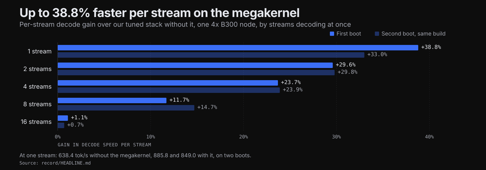
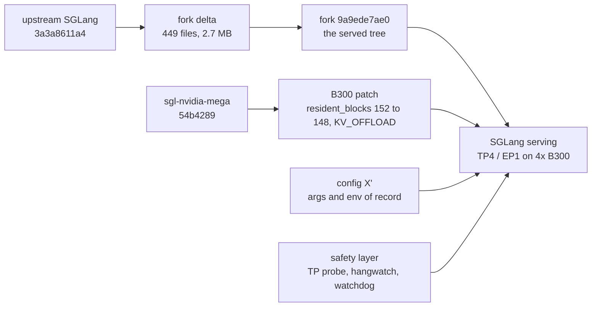

<div align="center">


# megakernel-b300

**DeepSeek-V4.1-Flash at 870.2 tok/s per stream on 4× B300, with NVIDIA's GB300 megakernel patched for 148 SMs.**<br>
The published article, the measured record with its raw data, and the setup kit to rebuild config X'.

[](#results)
[](#results)
[](#results)
[](setup/sglang-fork/README.md)
[](setup/patches/sgl-nvidia-mega-b300-spec.patch)
[](https://ezolabs.io/research/megakernel-b300)

[Results](#results) · [How it works](#how-it-works) · [Reproduce](#reproduce) · [Layout](#repository-layout) · [Provenance](#provenance) · [Article](https://ezolabs.io/research/megakernel-b300)

<br>

<picture>
  <source media="(prefers-color-scheme: light)" srcset=".github/assets/hero-light.svg">
  
</picture>

</div>

<br>

NVIDIA's `sgl-nvidia-mega` megakernel was written and measured on 4× GB300, whose GPUs carry 152 streaming multiprocessors (SMs). The B300 boards here carry 148, and the plugin's shipped requirements gate refused to start on them. This repository holds the two-line patch that lowered the gate and the safety layer built around the plugin. `record/` holds the measurements, and `article/` the post.

It is for the reviewer who wants the measurement behind <https://ezolabs.io/research/megakernel-b300>, and for the engineer who wants to rebuild the stack that served it.

## Results

Every figure below is quoted from [`record/HEADLINE.md`](record/HEADLINE.md) or from the record file named in its row. `HEADLINE.md` ties each number to its method, its conditions and a row of [`record/data/measurements.csv`](record/data/measurements.csv).

| what | figure | record |
| --- | --- | --- |
| decode per stream, C1 | **870.2 tok/s, the mean of 14 boot means** (each boot weighted once; boot means 841–907). Pooled over 208 requests: p50 865.2, p90 954.0, max 1,063.8 | [`speed.md`](record/speed.md) §1 |
| decode per stream, C2 / C4 / C8 | 694.3 / 554.4 / 396.2 tok/s | [`speed.md`](record/speed.md) §1 |
| decode per stream, C16 | 297.9 tok/s; the megakernel is neutral at this width (+1.1%) | [`measurements.csv`](record/data/measurements.csv) M06 |
| aggregate decode, C8 | 2,900 tok/s (2,804–2,900 over boots) | [`speed.md`](record/speed.md) §1 |
| megakernel speed-up vs the tuned non-megakernel stack | **+38.8% / +29.6% / +23.7% / +11.7% / +1.1%** at C1 / C2 / C4 / C8 / C16 | [`megakernel.md`](record/megakernel.md) |
| TTFT, C1, warm | **26.8 ms** (box-b); 39 ms p50 over all boots | [`speed.md`](record/speed.md) §2 |
| cold prefill | **69,494 tok/s** (60k-token prompt in 0.869 s, box-b); 62,666 tok/s at 100k | [`speed.md`](record/speed.md) §2–3 |
| 1 M-token prompt | **979,971 tokens in 15.4 s** | [`speed.md`](record/speed.md) §3 |
| live production decode (ITL p50) | 869 tok/s (box-a), 920 tok/s (box-b); live acceptance ≈ 4.0 tokens/step | [`speed.md`](record/speed.md) §2 |
| cost at C1 | **−28% per output token** with the megakernel | [`speed.md`](record/speed.md) §4 |
| hang rate, shipped config X' | **≤ 0.194 per loaded hour** (95%) = 2.996 / 15.43 h with 0 hangs on `4943d6ed90`; ≤ 0.342 = 2.996 / 8.76 h on `9a9ede7ae0` | [`stability.md`](record/stability.md) |
| quality | nothing worse than the non-megakernel stack in 9 suite pairs; L3a sign-off 21/21 rows PASS; NVIDIA's KL test under its bounds on every boot, worst 0.0205 long (2.9× under) | [`quality.md`](record/quality.md) |

### B300 against GB300, as the record frames it

| | NVIDIA, 4× GB300 (published) | us, 4× B300 (patched; unsupported as shipped) | record |
| --- | --- | --- | --- |
| hardware | Grace-Blackwell GB300, 152 SMs/GPU (the plugin's hard floor) | B300 HGX, **148 SMs/GPU**, x86 host; refused by the shipped plugin | [`b300-vs-gb300.md`](record/b300-vs-gb300.md) §2 |
| megakernel gain, 1–8 concurrent | +12–38% per-user decode (8K/1K, simulated acceptance 3.51) | **+11.7–38.8%** per-stream decode (C1–C8, real acceptance) | same shape; conditions differ |
| single-request decode | 928.4 tok/s P90 (AgentX replay); 945.96 tok/s p90 (PR screen) | **870 tok/s per-boot mean** (14 boots, 841–907); p90 954 / max 1,064 over 208 pooled requests (128 of them from one 4-boot run) | workloads differ: not a ranking |
| total throughput | 6,904 tok/s/GPU (AgentX, C1, prefill included) | 2,804–2,900 tok/s aggregate decode per box at C8 (≈ 700–725 per GPU); 4,227 at C16 (MK2, 10-28) | not comparable: their figure counts prefill tokens, ours counts generated tokens only |
| quality evidence | none published ("not an accuracy result") | full battery, nothing worse than the non-megakernel stack; L3a sign-off 21/21 | ours only |
| stability evidence | none published; the community 4× B200 port reports ~1 hang per 6 h | 0 hangs, 0 rank desyncs: 13,410 soak + 7,408 production requests (10-30); shipped config X' ≤ 0.19 hangs per loaded hour (95%) | ours only |
| B300 support upstream | added after us: opt-in `sm148` (PR #35, 10-30 20:12Z), speed measured at one request | the patch from 10-28; measured C1–C16, max-running 64 | [`b300-vs-gb300.md`](record/b300-vs-gb300.md) §2 |

> [!IMPORTANT]
> These caveats bound every number above, from [`record/HEADLINE.md`](record/HEADLINE.md) and [`record/b300-vs-gb300.md`](record/b300-vs-gb300.md):
>
> - **The boot is the unit.** Single-boot C1 means range 841–907 tok/s on identical code. Trust distributions and gated comparisons, not one boot.
> - **This is not a GB300 ranking.** Workloads, weights, draft acceptance and statistics differ from NVIDIA's published figures. What carries over is the relative gain on hardware the code was not written for ([`b300-vs-gb300.md`](record/b300-vs-gb300.md), "What not to claim").
> - **Bench shape.** Speed rows use short synthetic prompts and 300-token replies on an idle box; long-context rows are measured separately.
> - **Hang rate is bounded, not shown to be zero.** 0 hangs in 15.43 loaded hours on `4943d6ed90` gives a 95% upper bound of 0.194 per loaded hour; it does not prove the rate is zero, and it cannot yet rule out the community B200 port's observed hanging rate.
> - **The B300 patch is unofficial.** Upstream's own `sm148` opt-in arrived later (PR #35, merged 2026-10-30) and is the supported route; it replaces the shipped kernel slots and does not add `KV_OFFLOAD`, which is why the record stayed on the patch.
> - **Quality sets are small.** Most eval rows (100–300 items) would miss a drop of about 7–15 points; MMLU-Pro (12,028 items) is the tight one but scores prefill only, not generation.

## How it works



The engine is SGLang at fork commit `9a9ede7ae0`, which sits on upstream `sgl-project/sglang` commit `3a3a8611a4`; the fork's whole delta is [`setup/sglang-fork/fork-vs-upstream-3a3a8611a4.diff`](setup/sglang-fork/fork-vs-upstream-3a3a8611a4.diff) (449 files, 64,558 insertions, 2.7 MB, 152 commits). The plugin is `sgl-project/sgl-nvidia-mega` at `54b4289`, installed over the same venv with the patch in [`setup/patches/`](setup/patches).

The patch is two lines in `sgl_nvidia_mega/deepseek_v41/spec.py` and changes no kernel:

| change | before | after | why |
| --- | --- | --- | --- |
| `resident_blocks` | `152` (the GB300 SM floor) | `148` (B300) | the persistent GEMM schedule and its Lamport consumer were sized to one block per GB300 SM |
| `features` | `frozenset({Feature.SPECULATIVE_DECODING})` | `frozenset({Feature.SPECULATIVE_DECODING, Feature.KV_OFFLOAD})` | accepts the HiCache host-offload path the config of record runs |
| kernel code | unchanged | unchanged | [`plugin-apply-check.txt`](setup/sglang-fork/plugin-apply-check.txt) is `git apply --check` at exit 0 |

The safety layer is not optional in the record. It is three things: a TP-consistency probe inside the fork (`SGLANG_MK_TP_PROBE=1`, on every 100th scheduler iteration in serving, `SGLANG_MK_TP_PROBE_ASSERT=1` to fail stop), [`setup/safety/hangwatch.py`](setup/safety/hangwatch.py) to capture a stalled engine and kill it, and [`setup/box/watchdog.sh`](setup/box/watchdog.sh) to relaunch a dead or unresponsive engine without restarting a merely busy one. Detail: [`setup/safety/README.md`](setup/safety/README.md) and [`record/stability.md`](record/stability.md).

## Reproduce

The full runbook is [`setup/README.md`](setup/README.md). The steps of record, in order:

1. **Prerequisites.** One box with 4× NVIDIA B300 SXM6 (sm_103, 148 SMs, 275,040 MiB each), the driver of record, the container image digest, the venv freeze, and the model weights:

   | | of record |
   | --- | --- |
   | driver / CUDA | box-a: 580.173.02 / CUDA 13.0. box-b: 580.178.04 |
   | container image | `lmsysorg/sglang:dev-dsv41@sha256:4a5d132a06a77c8331e15845f2e925adc788b00105097ad55409afa3f4fa4860` |
   | Python | the megakernel venv's full freeze, [`setup/config/pip-freeze-sglang-mk29.txt`](setup/config/pip-freeze-sglang-mk29.txt) |
   | model | `<MODEL_PATH>`, the L3a repack of `deepseek-ai/DeepSeek-V4.1-Flash-1017`, 510 GB. Not in this repository |
   | disk | 1,500 GB (`DISK_GB=1500`) |

2. **Build the engine.** Apply the fork delta to the upstream commit and install it editable:

   ```bash
   git clone https://github.com/sgl-project/sglang.git sglang
   cd sglang
   git checkout 3a3a8611a45f5a81fd07ffa6b0ed3ba33e7a4db9
   git apply --exclude='test/srt/sbr/fixtures/*.jsonl.gz' /path/to/setup/sglang-fork/fork-vs-upstream-3a3a8611a4.diff
   ```

   The two excluded files are test fixtures: not shipped, and not needed to serve.

   ```bash
   /opt/sglang/bin/uv pip install --python /opt/sglang-mega/bin/python3 --no-deps --no-build-isolation -e /workspace/mega/sglang/python
   ```

3. **Build the plugin with the B300 patch.** Apply and install it into the same venv:

   ```bash
   git clone https://github.com/sgl-project/sgl-nvidia-mega.git sgl-nvidia-mega
   cd sgl-nvidia-mega
   git checkout 54b428921749fef89fcbd043000f839ac9cc4638
   git apply --check /path/to/setup/patches/sgl-nvidia-mega-b300-spec.patch   # exit 0
   git apply        /path/to/setup/patches/sgl-nvidia-mega-b300-spec.patch
   ```

   ```bash
   /opt/sglang/bin/uv pip install --python /opt/sglang-mega/bin/python3 -e /workspace/mega/sgl-nvidia-mega-b300
   ```

   Use the patch, not upstream's later `sm148` slot list: `SGLANG_NVIDIA_MEGAKERNEL_SLOTS=sm148` replaces the 39 shipped slots and does not add `Feature.KV_OFFLOAD` ([`record/b300-vs-gb300.md`](record/b300-vs-gb300.md) §2).

4. **Boot config X'.** `stage.sh` puts the tool set on the box and seeds the env from the box sheet's `ENV_SEED`; `restart.sh` starts one engine with an explicit args/env pair:

   ```bash
   (cd setup/box && BOX=box-a bash stage.sh)    # the tool set to /workspace/tools
   ```

   ```bash
   (cd setup/box && BOX=box-a bash restart.sh box-a-mkr-B1 <mkr-args> <mkr-env>)
   ```

   A megakernel boot waits ~690–800 s (the plugin's JIT and autotune), so `WATCHDOG_BOOT_GRACE=2700` in the box sheet is the figure to keep. On a fresh box the orchestrator is:

   ```bash
   bash bringup.sh <args-file> [--offer <offer-id> | --instance <instance-id>]
                   [--engine-args <per-copy args-file>] [--dry-run]
   ```

   The args and env of record are [`setup/config/stack-b300-box-a-mk2.args`](setup/config/stack-b300-box-a-mk2.args) and [`setup/config/env-box-a-mk2.txt`](setup/config/env-box-a-mk2.txt); [`setup/config/stack-b300-box-a-mk.args`](setup/config/stack-b300-box-a-mk.args) with [`setup/config/env-box-a-mk.txt`](setup/config/env-box-a-mk.txt) is the config X rollback pair. Every flag and its reason is tabulated in [`record/fork-and-config.md`](record/fork-and-config.md) §1.

5. **Start the safety layer.** The TP probe is on through the env of record. The box sheet's `HANGWATCH_CMD` starts the stall watcher once per boot:

   ```bash
   python3 /workspace/mk29/harness/hangwatch.py --service --on-hang kill \
       --out /workspace/mk29/watch/serving --dump-signal none
   ```

   `--dump-signal none` is required here: the ranks' USR2 catcher is LLVM/Triton's `SA_RESETHAND` handler, so the default dump signal would kill the rank.

6. **Bench and gates.** The headline decode figures are `bench.py think-ramp`: four synthetic reasoning prompts, thinking on, T 1.0 / top_p 1.0, 300 completion tokens, C streams started together, 8 reps per C (32 at C1 in the settle run), seed 4242 + C. Run with the box out of every router pool and `--max-live 0`:

   ```bash
   # C1, C2, C4, C8 at 8 reps each + 8 x 60k cold fills; cwd /workspace/mk29/speed178
   L=<label> bash raw__speed__bench178.sh
   # C1 at n=32 (the settle run); cwd /workspace/mk29/c1settle
   L=<label> bash c1-settle__bench-c1.sh
   ```

   The gate over two boots against a base:

   ```bash
   python3 bench/gates.py --arm b1=$R/raw@<L1> --arm b2=$R/raw@<L2> --base final=$R/raw@<F> \
       --copies 1 --base-copies 1
   ```

   A regression counts only when it replicates beyond the A/A band on both boots; `OVERALL PASS` means no regression.

7. **Quality checks.** NVIDIA's KL test is the per-boot gate; the rest of the battery is in [`setup/quality/`](setup/quality):

   ```bash
   python3 quality/nvidia_kl.py --url http://127.0.0.1:8002 --mode both --repeats 3 --out kl.json
   ```

   Bars are `KL_BOUND` 0.03 short and `LONG_KL_BOUND` 0.06 long, exit 1 on a miss. The L3a sign-off (21/21 rows PASS on the 10-29 boot) is not in this repository; its command is in [`setup/README.md`](setup/README.md) §7.

## Repository layout

```
megakernel-b300/
├── README.md
├── article/          the published post
│   ├── megakernel-b300.md   the post
│   ├── figures/             four SVGs; three with the CSVs behind them
│   ├── tables/              the three tables as CSV
│   └── rendered/            a rendered copy of the page
├── record/           the performance record, verbatim
│   ├── HEADLINE.md          every headline number on one page
│   ├── speed.md megakernel.md stability.md quality.md fork-and-config.md fleet-ops.md methodology.md b300-vs-gb300.md
│   └── data/                measurements.csv, decode-distribution.csv, raw/, scripts/
├── setup/            the runbook and the kit
│   ├── README.md            the bring-up runbook
│   ├── MANIFEST.tsv         every copied file's source repo, commit, path and scrub note
│   ├── patches/             the B300 plugin patch and the other plugin/fork patches
│   ├── config/              the args and env of record (X', X), the arms, the box sheets, the venv freeze
│   ├── box/                 bringup, build-onstart, stage, restart, relaunch, watchdog, the onstart template
│   ├── safety/              the TP-probe material, hangwatch.py, the probe's selftest
│   ├── bench/               bench.py, acc.py, the two wrappers, gates.py, decode_distribution.py
│   ├── quality/             nvidia_kl, dsml_compare, synthmix, test_harness, quality/*
│   └── sglang-fork/         the fork delta, its commits, the plugin apply-check
└── .github/assets/   logo-tile.svg, hero-dark.svg, hero-light.svg, social-preview.png
```

## Known gaps

- **The model weights.** The boxes served an L3a repack of `deepseek-ai/DeepSeek-V4.1-Flash-1017` (510 GB), served as `DeepSeek-V4.1-Flash`. The checkpoint is public; the repack is not. Point the box sheet's `MODEL_DIR` at your own weights and the stack runs, but the numbers are the repack's.
- **`tf.py` and `tfcmp.py`**, the teacher-forced comparison tools. They are in no repository; the comparison outputs they produced are in [`record/data/raw/megakernel/`](record/data/raw/megakernel).
- **The fork's git history.** Only the delta and the commit list are here.
- **`ENV_SEED=env-box-a-mk3.txt`.** box-a's box sheet names it, and that file is not in this tree. To boot config X', set `ENV_SEED=env-box-a-mk2.txt` in the box sheet (`env-box-a-mk.txt` for X). `stage.sh` refuses a seed name under `args/` that is not there, so this matters.

## Provenance

| layer | pin | in this repository |
| --- | --- | --- |
| article | the published post | `article/` |
| record | internal record commit `b046a10b` | `record/` |
| engine fork | our SGLang fork `9a9ede7ae0`, on upstream `sgl-project/sglang` `3a3a8611a4` | `setup/sglang-fork/` |
| plugin | `sgl-project/sgl-nvidia-mega` `54b4289` + [`setup/patches/sgl-nvidia-mega-b300-spec.patch`](setup/patches/sgl-nvidia-mega-b300-spec.patch) | `setup/patches/` |

[`setup/MANIFEST.tsv`](setup/MANIFEST.tsv) records every copied file's source repository, source commit, source path, whether it was scrubbed and what was replaced.

Checks before publishing: [`record/data/scripts/sanitize_scan.sh`](record/data/scripts/sanitize_scan.sh) exits 0 over `record/` (123 files). `gitleaks detect --no-git --source . -v` was run from the repository root with [`.gitleaksignore`](.gitleaksignore), and `trufflehog filesystem` over the whole tree: the two gitleaks hits are confirmed false positives pinned there, and trufflehog's one unverified hit is the md5 of a box script in [`setup/box/installed/watchdog.run`](setup/box/installed/watchdog.run). No operator paths, personal email addresses or live IP addresses were found.

## Citation

```bibtex
@misc{ezolabs2026megakernel,
  author       = {EZO Labs},
  title        = {DeepSeek-V4.1-Flash breaks 1,000 tokens per second for one user: how we roughly doubled decode in five days},
  year         = {2026},
  howpublished = {\url{https://ezolabs.io/research/megakernel-b300}},
  note         = {EZO-R-2026-07}
}
```
